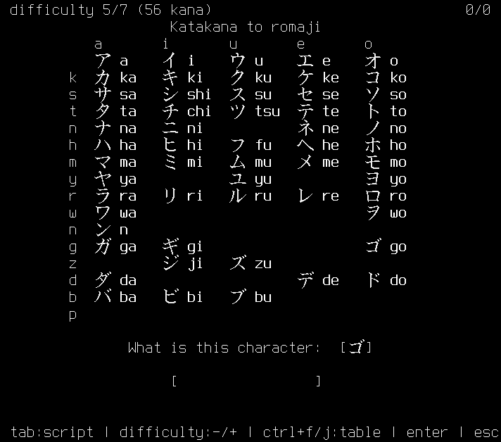

# romajira

romajira is a single-file terminal flashcard trainer for drilling the romaji readings of hiragana and katakana.

Run it with `python3 romajira.py` or just `./romajira.py`.

## Dependencies

None. romajira is one Python 3 file using only the standard library (`curses`); any terminal with a UTF-8 locale works.

## Project intent

Reading kana has to become automatic before it's useful, and that only happens through fast, repeated recall. romajira is a minimal drill for exactly that: it shows one random character, you type the romaji, and it keeps score.

- Answers are checked leniently — common alternative romanizations are accepted (`shi`/`si`, `tsu`/`tu`, `wo`/`o`, `ji`/`zi`, …), so spelling conventions never interrupt the drilling.
- A first miss reveals a masked hint (one character hidden); kana with several accepted romanizations show every spelling, each masked. A second miss shows the full answer, and the character stays up until you get it right.
- Tab switches between the hiragana and katakana pools.
- Ctrl+F / Ctrl+J toggles a kana reference table you can keep open while drilling; it shows only the characters in the current difficulty pool, and its contracted-sounds section appears only at difficulty 7.

## Difficulty

The drill starts at difficulty 6, where every base kana is in the random pool. Press `-` to make it easier and `+` (or `=`) to make it harder — difficulty 7 adds the contracted sounds.

Difficulty 6 covers all base kana (71 symbols).

Difficulty 7 adds the contracted sounds — きゃ, しゅ, ちょ, りょ, … — for 104 glyphs in all; their alternative spellings (`sha`/`sya`, `ju`/`zyu`, …) follow the same lenient checking as the base kana.

Difficulty 1 covers only very common kana (12 symbols).

## Notes

Alternative romanizations reflect more than one transliteration convention (Hepburn and others), and the drill accepts any of them so a valid spelling never interrupts the flow. The card displays only one spelling, treated as primary:

- を shows `wo` but also accepts `o`.
- じ shows `ji` but also accepts `zi`; ぢ shows `ji` but also accepts `di`.
- づ shows `zu` but also accepts `du`.

Since じ and ぢ share the reading `ji`, and ず and づ share `zu`, accepting every spelling means the drill cannot tell which kana you intended. That keeps recall frictionless, but it does not exercise the (mostly historical) distinction between those pairs — and accepting `o` for を leans on a convention other than the `wo` shown on the card. To drill a single convention strictly, type the displayed spelling.

